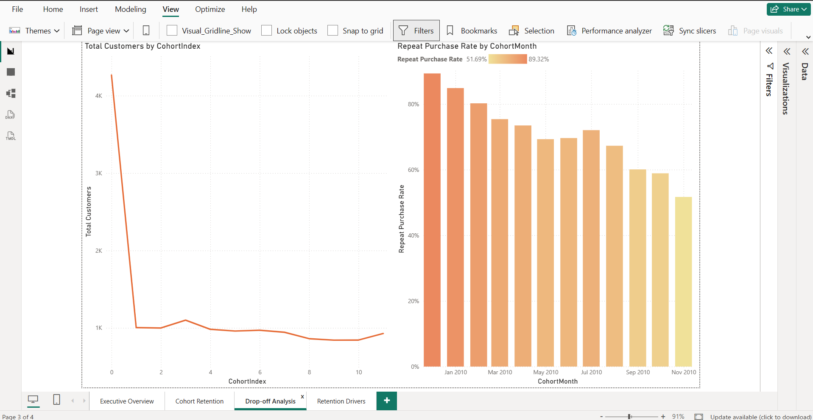
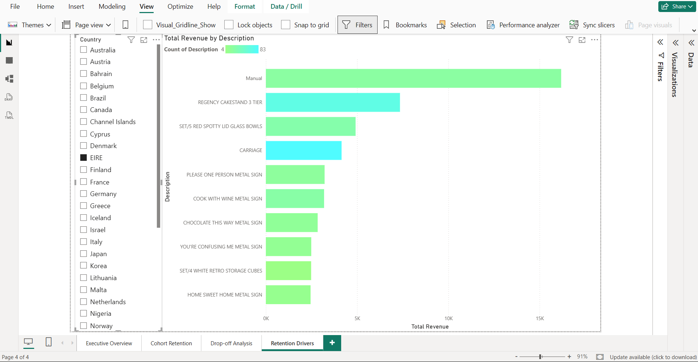

# E-Commerce Customer Retention & Cohort Analysis

**Tools Used:** SQL (SQLite), Python (Pandas, NumPy), Power BI

## Project Overview
Analyzed a public e-commerce transactional dataset of 50,000+ order records (779,000+ cleaned line items) to evaluate customer retention, track repeat-purchase behavior across 12 monthly acquisition cohorts, and recommend targeted retention strategies.

## Workflow & Methodology
1. **Data Cleaning (SQL):** Removed null `CustomerID` records, cancelled invoices (`Invoice` starting with `C`), duplicate entries, and invalid quantities/prices, and engineered a `TotalRevenue` column (`Data_cleaning.sql`).
2. **Cohort Segmentation (Python):** Grouped customers by initial acquisition month (`CohortMonth`), calculated monthly lifecycle intervals (`CohortIndex` 0–11), and built a 12-month retention matrix.
3. **Interactive Dashboard (Power BI):** Built a 4-page interactive dashboard covering Executive KPIs, a 12-Month Cohort Retention Heatmap, First-Purchase Drop-Off Curves, and Country/Product Retention Drivers.

## Dashboard Preview

### 1. Executive Overview

### 2. 12-Month Cohort Retention Heatmap

### 3. First-Purchase Drop-Off & Retention Curve

### 4. Country & Product Retention Drivers

## Key Findings & Business Recommendations
* **Steep Post-Purchase Drop-Off:** Customer retention drops sharply after the initial purchase (Month 0 to Month 1), averaging ~15–25% retention in Month 1 across cohorts.
* **Cohort Stabilization:** Customers who return in Month 1 and Month 2 demonstrate strong long-term stickiness through Month 11.
* **Actionable Recommendations:**
  * Launch an automated **Day-14 post-purchase win-back email** with a 10% second-order incentive targeting first-time buyers before Month 1 churn occurs.
  * Introduce a **tiered loyalty reward** after a customer's 2nd order to accelerate transition into high-LTV repeat segments.
